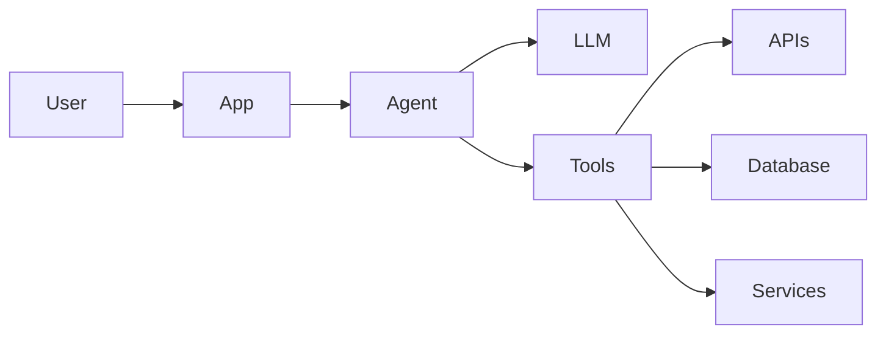

<div align="center">

# 👋 Hey, I'm Kevin Barreto

### Full-Stack & Mobile Software Developer

**Web · Mobile · Backend · AI-Assisted Development**

<br>

[](https://www.linkedin.com/in/kevin-barreto-bonilla/)
[](https://github.com/kbarreto23)

</div>

---

## 👨‍💻 About Me

Full-Stack Software Developer focused on building **web, mobile and backend applications** that solve real-world problems.

I work across the entire application lifecycle — from UI and mobile development to **APIs, databases, authentication, integrations and containerized environments**.

Currently expanding my development workflow into **AI-assisted engineering and agentic systems**, using tools like **Claude Code** and exploring AI Agents, MCP, tool calling and LLM integrations.

---

## ⚡ Core Stack

### Frontend & Mobile


### Backend & Databases


### DevOps & Tools


---

## 🤖 AI-Assisted & Agentic Development

I'm actively exploring how **AI can become part of the software architecture**, not just a tool for generating code.


**Currently exploring:**

`Claude Code` · `AI Agents` · `MCP` · `Tool Calling` · `LLM APIs` · `Context Engineering` · `Agentic Workflows`

### Agent Architecture



---

## 🚀 What I'm Focused On

```text
Web & Mobile Development
        ↓
Backend Systems & APIs
        ↓
AI Integration
        ↓
Tool-Enabled Agents
        ↓
Agentic Applications
```

My current goal is combining traditional **software engineering** with modern **AI capabilities** to build applications where agents can interact with APIs, databases and external tools to perform real-world tasks.

---

## 📊 GitHub Stats

<div align="center">


</div>

---

<div align="center">

### Build · Automate · Iterate 🚀

**Full-Stack · Mobile · Backend · AI**

<br>


</div>
